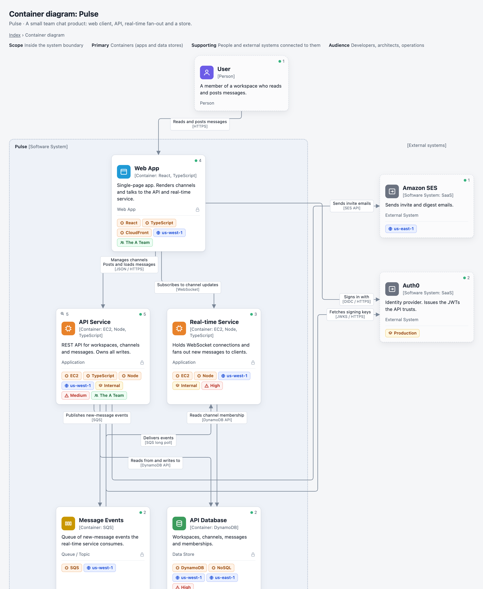
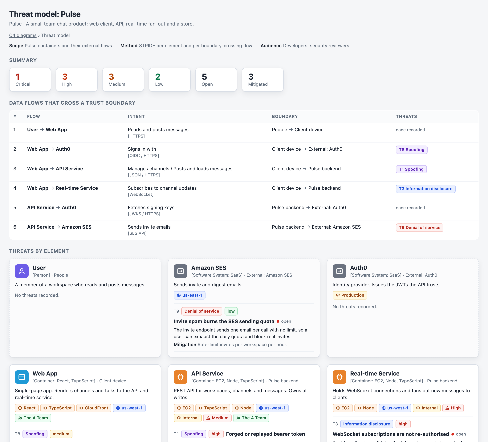
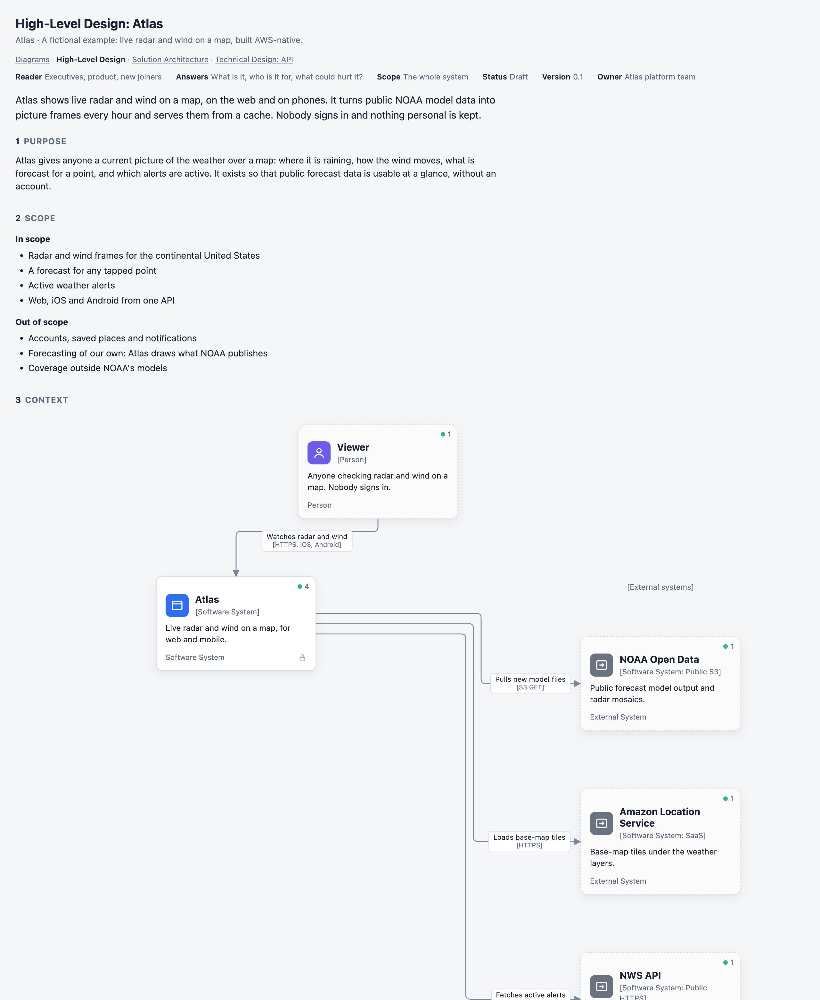

# public-skills

Agent skills that work in Claude Code, Cursor, GitHub Copilot and Codex. Each skill is a folder with a `SKILL.md`.

| skill | what it does |
| --- | --- |
| [`c4-diagrams`](skills/c4-diagrams/SKILL.md) | Reads a codebase and renders C4 architecture diagrams as light-mode HTML in `outputs/c4/` |
| [`design-docs`](skills/design-docs/SKILL.md) | Reads the C4 model and the code and writes an HLD, SAD or TDD as HTML in `outputs/hld/`, `outputs/sad/`, `outputs/tdd/` |
| [`threat-model`](skills/threat-model/SKILL.md) | Reads the C4 model and writes a STRIDE threat model as HTML in `outputs/threat-model/` |



Point at a line or a card to trace a relationship. Open [`examples/index.html`](examples/index.html) for the full sample set, and [`examples/threat-model/index.html`](examples/threat-model/index.html) for the matching threat model.



## Which document

One model, six documents. Each answers one question for one reader, and a fact lives in one of them only.

| document | reader | question | scope | skill |
| --- | --- | --- | --- | --- |
| System Context | Everyone | Who uses it, and what does it depend on? | The system as one box | `c4-diagrams` |
| Container | Engineers, operations | What runs, what stores data, how do they talk? | Inside the system | `c4-diagrams` |
| Component | Developers of one container | What is inside this container? | One container | `c4-diagrams` |
| High-Level Design | Executives, product, new joiners | What is it, who is it for, what could hurt it? | The whole system | `design-docs` |
| Solution Architecture | Architects, tech leads | Why this shape, and does it meet its goals? | The whole solution | `design-docs` |
| Technical Design | Engineers on one container | How does it work, how do I change and run it? | One container | `design-docs` |



[`examples/atlas/`](examples/atlas/) is a whole outputs folder for a made-up, simplified system: the [diagrams](examples/atlas/c4/index.html), an [HLD](examples/atlas/hld/index.html), a [SAD](examples/atlas/sad/index.html) and a [TDD](examples/atlas/tdd/api.html).

## Runbook

```bash
git clone https://github.com/coffeestained/public-skills.git
cd your-project
# pick the folder your tool reads
cp -r ../public-skills/skills/c4-diagrams .claude/skills/c4-diagrams   # Claude Code
cp -r ../public-skills/skills/c4-diagrams .cursor/skills/c4-diagrams   # Cursor
cp -r ../public-skills/skills/c4-diagrams .github/skills/c4-diagrams   # GitHub Copilot
cp -r ../public-skills/skills/c4-diagrams .agents/skills/c4-diagrams   # Codex
cp ../public-skills/skills/c4-diagrams/config.json.example config.json  # optional
# then ask your agent: "generate C4 diagrams for this project"
open outputs/c4/index.html
```

Swap `c4-diagrams` for `design-docs` or `threat-model` to install the others. A symlink works too. Both read `outputs/c4/model.json`, so run `c4-diagrams` first. A TDD also needs `"component"` in `levels`.

## Contributing

Styles, icons, the diagram engine and `fill()` live once in `shared/` and are stamped into each skill, so a copied skill folder stays self-contained.

```bash
python3 tools/stamp.py    # after editing shared/
python3 tools/check.py    # before a commit: blocks stamped, examples current, bad documents refused
```

When `check.py` says the examples are stale, render them again; `git diff examples/` shows what changed.

## License

MIT, Matthew Grady.
